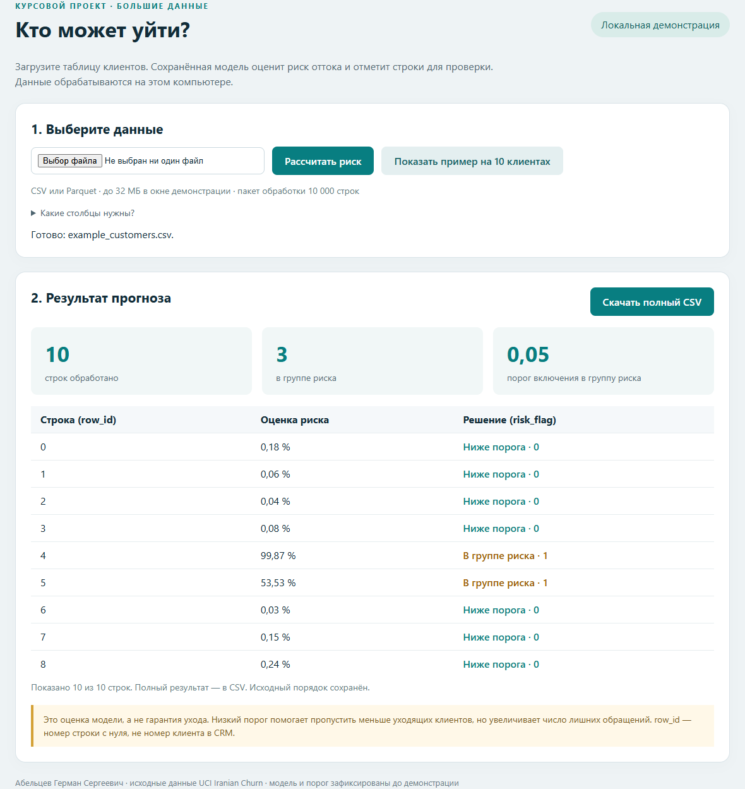

# Прогнозирование оттока клиентов

## Открыть программу в браузере

**[Запустить интерактивную демонстрацию](https://german-coursework-lab.lastingpiece10.chatgpt.site/data/)**

Сохранённая модель рассчитывает прогноз прямо на устройстве: можно изменить профиль, открыть пример или обработать CSV. Установка и регистрация не нужны, введённые данные не отправляются на сервер. Это дополнительная версия для демонстрации: CSV до 8 МБ и 10 000 строк. Parquet, обучение и обработка больших файлов остаются в полной Python-программе. Предсказания сверены с сохранённой моделью на 4 150 профилях.

Курсовой проект по технологиям обработки больших данных. **Абельцев Герман Сергеевич**, группа Д-Э 18-25, РГАУ–МСХА имени К. А. Тимирязева. Руководитель — Демичев Вадим Владимирович.

Программа проверяет данные, применяет сохранённую модель и формирует список строк с риском оттока. Есть пакетный режим CSV/Parquet и локальное окно загрузки, просмотра и выгрузки результата.



## Запуск в Windows

Нужен **Python 3.12**. Обученная модель включена; повторное обучение для показа не требуется.

1. Скачать **Code → Download ZIP** и полностью распаковать проект.
2. Один раз открыть **Установить зависимости.bat**. Для загрузки библиотек нужен интернет. Дождаться сообщения «Готово».
3. Открыть **Запустить программу.bat**. Адрес: http://127.0.0.1:8767.
4. Нажать **Показать пример на 10 клиентах**. Ожидается **10 строк и 3 флага риска**.
5. Скачать CSV. Для завершения нажать Ctrl+C в окне запуска.

На macOS/Linux создать окружение Python 3.12, установить `requirements.txt` и выполнить `python src/web.py`. GitHub показывает исходный код; Python-программа запускается на компьютере.

## Вход и результат

Обязательные признаки: Call Failure, Subscription Length, Charge Amount, Seconds of Use, Frequency of use, Frequency of SMS, Distinct Called Numbers, Complains, Tariff Plan. Метка Churn для прогноза не нужна.

На выходе `row_id`, `probability`, `risk_flag`. Номера строк начинаются с нуля; это не идентификаторы CRM. При пороге 0,05 пример отмечает строки 4, 5 и 9. Оценка модели не является гарантией ухода.

Окно демонстрации принимает файл до 32 МБ, показывает первые 100 строк и выгружает весь результат. Для больших файлов используется командная версия:

```sh
python src/churn.py predict --input data/example_customers.csv --output results/new_predictions.csv
python -m unittest discover -s tests -v
```

Выходной файл должен быть новым. По умолчанию пакет равен 10 000 строк; размер меняется через `--batch-size`. Собственную модель можно воспроизвести через `python src/churn.py train`; эта команда обновляет контрольные результаты, поэтому запускать её лучше в отдельной копии. Загружать следует только доверенный файл модели.

## Проверяемые результаты

- После удаления 300 полных повторов: **2 850 записей**, 446 случаев оттока.
- Обучение / валидация / тест: **1 707 / 572 / 571**, одинаковые профили не пересекаются.
- На тесте: **AP 0,9003**, ROC AUC 0,9742.
- При пороге 0,05: **88 найденных случаев, 2 пропуска, 61 ложная тревога**.
- **24 автоматические проверки**, совпадение CSV и Parquet и контрольного прогноза.
- Нагрузка до 500 000 строк сформирована повторением профилей. Это проверка производительности, а не новая реальная выборка. Интерфейс не включён в прежний нагрузочный замер.

Модель не объявляется готовой к промышленному внедрению: нужны новый период, проверка переноса, калибровка и оценка стоимости контактов. Экономический эффект не измерялся.

## Файлы

- [Расчёт и обучение](src/churn.py): `validate_features`, `predict_frame`, `predict_file`.
- [Локальный сервер](src/web.py) и [интерфейс](src/interface.html).
- [Результаты и модель](results), [тесты](tests), [блокнот](analysis.ipynb).
- [Курсовая, презентация и речь](Материалы) — PDF, Word и PowerPoint. 14 слайдов; речь примерно 7–8 минут.

## Источник данных

**Iranian Churn [Dataset]. (2020). UCI Machine Learning Repository.** [DOI 10.24432/C5JW3Z](https://doi.org/10.24432/C5JW3Z), [страница набора](https://archive.ics.uci.edu/dataset/563). Лицензия **CC BY 4.0**. Подробности источника и преобразований — в [data/SOURCE_AND_LICENSE.txt](data/SOURCE_AND_LICENSE.txt). Авторы исходных данных не заявляли об одобрении проекта.
